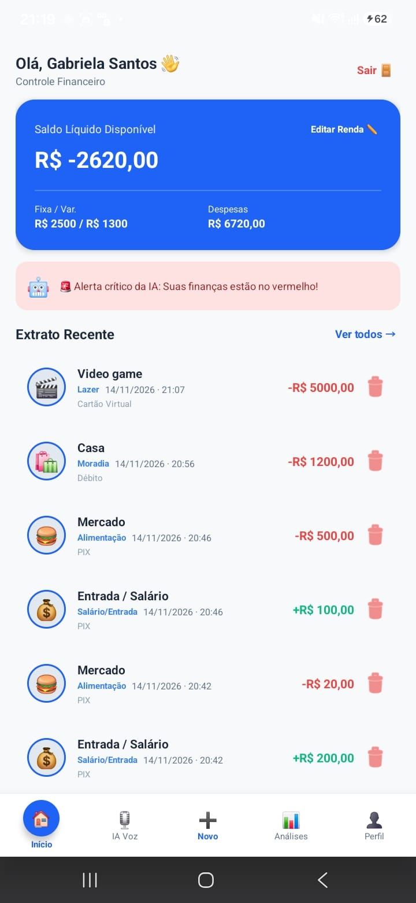

# 💰 MeuControle — Gestão Financeira Inteligente

**Aplicativo Android de Gestão Financeira Pessoal**

Trabalho Acadêmico em Grupo — Análise e Desenvolvimento de Sistemas (ADS) | UNICID

---

## 📖 1. Sobre o Projeto

O **MeuControle** é uma aplicação nativa para Android, desenvolvida em Java, com o objetivo de auxiliar os utilizadores na organização e no controlo das suas finanças pessoais.

O aplicativo oferece uma experiência simples e intuitiva para registar receitas, acompanhar despesas, consultar saldos e visualizar análises financeiras.

O projeto utiliza uma arquitetura com armazenamento local, autenticação de utilizadores e recursos de automação, priorizando a praticidade, a organização e a privacidade dos dados.

---

## 🚀 2. Tecnologias Utilizadas

| Tecnologia | Finalidade |
|---|---|
| Java | Linguagem principal de desenvolvimento |
| Android SDK | Desenvolvimento da aplicação Android |
| XML | Construção das interfaces |
| Material Design Components | Componentes visuais |
| ConstraintLayout | Organização dos elementos da interface |
| Firebase Authentication | Autenticação e gestão de utilizadores |
| Room Database | Armazenamento local de dados |
| Google ML Kit | Reconhecimento de texto por OCR |
| MPAndroidChart | Criação de gráficos financeiros |

### Recursos complementares

- `GastoEntity` e `GastoDao`: estrutura e acesso aos dados financeiros.
- `IaVoxActivity`: funcionalidade de reconhecimento de texto.
- `AnalisesActivity`: apresentação de gráficos e análises.
- `PerfilActivity`: gestão das informações do utilizador.
- `BackupManager`: gerenciamento de cópias de segurança.
- `BancoNotificationListener`: monitoramento de notificações financeiras.

---

## 📱 3. Funcionalidades Principais

### 🔐 3.1. Autenticação e Segurança
- Cadastro de utilizadores.
- Login com e-mail e palavra-passe.
- Validação de campos e credenciais.
- Opção para visualizar ou ocultar a palavra-passe.
- Integração com Firebase Authentication.

### 🏠 3.2. Página Inicial e Controlo Financeiro
- Saudação personalizada.
- Visualização do saldo disponível.
- Registo e acompanhamento de receitas.
- Registo e acompanhamento de despesas.
- Extrato das movimentações financeiras.
- Atualização dos valores apresentados.

### 📊 3.3. Análises Financeiras
- Gráficos interativos.
- Visualização das despesas por categoria.
- Análise da distribuição dos gastos.
- Acompanhamento da organização financeira.

### 🤖 3.4. Leitor Inteligente
- Captura de fotografias de talões e comprovativos.
- Reconhecimento automático de textos através do Google ML Kit.
- Extração de informações financeiras para auxiliar no registo de despesas.

### 👤 3.5. Perfil e Configurações
- Visualização e gestão do perfil.
- Configurações da aplicação.
- Secção de ajuda.
- Recursos de backup e recuperação de dados.

---

## 📸 4. Capturas de Tela da Aplicação

A seguir, são apresentadas seis telas principais do MeuControle, demonstrando a interface e as funcionalidades da aplicação.

### 4.1. Tela de Login


### 4.2. Tela Inicial


### 4.3. Tela de Lançamentos


### 4.4. Tela de Análises


### 4.5. Tela de Perfil


### 4.6. Tela de Configurações


---

## 🏗️ 5. Arquitetura e Armazenamento

O MeuControle utiliza tecnologias que trabalham em conjunto para oferecer armazenamento, autenticação e processamento de informações.

- **Room Database:** responsável pela persistência local das informações financeiras.
- **Firebase Authentication:** responsável pelo processo de autenticação dos utilizadores.
- **Google ML Kit:** utilizado no reconhecimento de textos através de imagens.
- **MPAndroidChart:** utilizado na representação visual dos dados financeiros.

A aplicação foi desenvolvida para priorizar o funcionamento local das funcionalidades de gestão financeira.

---

## ⚙️ 6. Como Executar o Projeto

### Pré-requisitos

- Android Studio instalado.
- JDK compatível com a configuração do projeto.
- Android SDK configurado.
- Dispositivo Android ou emulador.
- Configuração do Firebase, conforme os requisitos do projeto.

### Instalação

1. Clone o repositório:

```bash
git clone https://github.com/teu-utilizador/MeuControle.git
```

2. Abra o projeto no Android Studio.

3. Aguarde a sincronização do Gradle.

4. Configure o Firebase e adicione o ficheiro `google-services.json` quando necessário.

5. Execute a aplicação num dispositivo Android ou emulador.

---

## 👥 7. Informações Académicas

**Projeto:** MeuControle — Gestão Financeira Inteligente

**Curso:** Análise e Desenvolvimento de Sistemas (ADS)

**Instituição:** Universidade Cidade de São Paulo (UNICID)

**Modalidade:** Trabalho Académico em Grupo

**Ano:** 2026

---

## 📄 8. Licença

Projeto desenvolvido para fins académicos e educacionais.

---

**MeuControle — Organização financeira na palma da mão.** 💙
